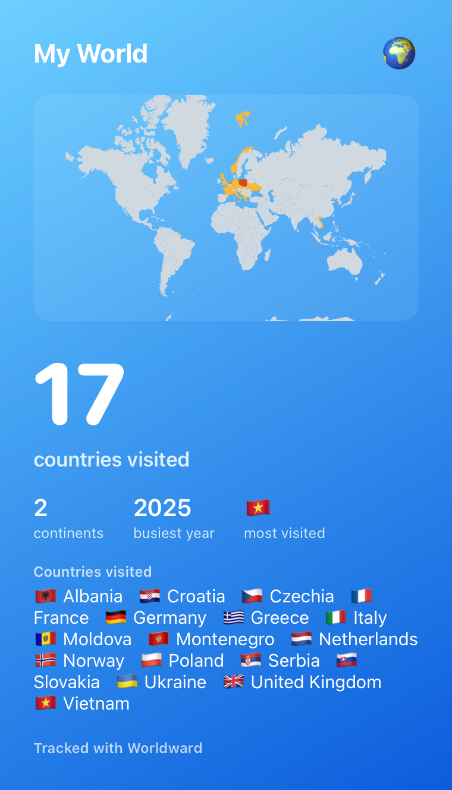
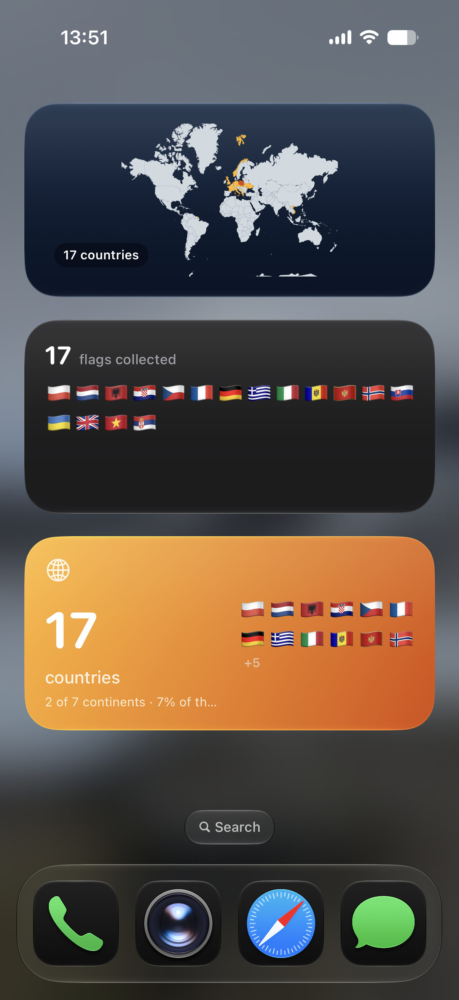

# Worldward 🌍

**Track your travels. Explore your world.**

Worldward is a native macOS / iOS app that visualises every country you've visited — crossed, lived in, or simply passed through — on an interactive world map. Built entirely with SwiftUI, MapKit, and SwiftData.

---

## Features

### Interactive Map
- Every country rendered as a tap-able map polygon from Natural Earth data (~250 countries).
- Warm yellow-to-orange fill per country status: **Crossed** → **Visited** → **Lived** → **Living**.
- A cool-blue **planning layer** on the same map — **Wishlist** and **Planning** countries tinted blue, with a blue ring on places you've both visited *and* want to return to.
- **Tap any country** to zoom in and open its detail sheet with visits, flag, and notes.
- **Search & fly-to** — type a country name in the search bar and tap a suggestion to animate the map directly to it.
- **Status filter bar** — toggle the map between All, Visited only, or Planning only countries.
- **Map style picker** (in Settings → Appearance) — choose from **Standard**, **Hybrid** (satellite + labels), or **Satellite** (pure imagery).
- A selected country's **flag annotation** floats above its location on the map.
- **Trip routes** — "View Route on Map" in any trip draws its itinerary as a dashed line with numbered stop badges and pins for saved places.

### Travel Log
- Record visits with dates and notes for every country you've been to.
- **Attach photos to any visit** from the system photo picker — thumbnails are fetched live from your Photo Library, and no image data is ever stored (only stable identifiers).
- Multiple visits per country, each with its own date and photo set; long-press a thumbnail to detach it.
- **Smart default date** — new visits default to one day after your most recent visit, reducing date-picking friction.

### Country Lists (Been / Going)
- The **Been** tab shows everywhere you've visited, with toolbar buttons for **Ask About Your Travels** (AI chat about your history) and **Statistics** (dashboard, timeline, charts, year recaps).
- The **Going** tab splits into **Trips**, **Wishlist**, and **Suggestions** — the Suggestions segment shows your closest unvisited countries and AI-powered destination picks.
- Grouped by continent with sort by name or most recently visited, plus continent and visit-year filters.
- **Quick-add** a country directly from the list toolbar — pick any country and it's marked as visited (Been) or added to your wishlist (Going).
- **Fuzzy search** matches names with diacritic and substring awareness ("cote" finds "Côte d'Ivoire", "USA" finds "United States").
- Discovery and status changes happen on the Map — tap any country to set its status or plan.

### macOS
- **Menu Bar Extra** — a globe icon in the menu bar showing your country count with quick actions: Open Worldward, Mark Current Location, and Quit.

### Trips (multi-country itineraries)
- The **Going** tab splits into **Trips** and **Wishlist**. A trip is multi-country *through its itinerary*: add ordered **stops**, each optionally tied to a country, and the trip's countries follow (Paris 🇫🇷 → Rome 🇮🇹 → Zurich 🇨🇭).
- Each trip has a **date range**, a reorderable **itinerary** (stops with optional dates/notes), a checkable **packing list**, and free-text **notes**.
- **Add to Apple Calendar** writes the trip as an all-day event (write-only EventKit access; it never reads your existing events).
- **Share / export** a trip as **Markdown** through the system share sheet — send it straight to **Apple Notes**, Messages, or Mail, or copy it into any Markdown editor.
- Adding a stop's country flips it to **Planning** on the map, so your trips light up the blue layer.

### Achievements 🏆
- Dedicated **Achievements** view from the **Map** tab toolbar — a badge grid with categories (Countries, Continents, Depth & Roots, Travel Log, Continent Mastery) and a hero counter.
- Every badge shows progress toward unlocking via an on-device computed `TravelStats` pass.
- Tap any badge for a detail sheet with its description and progress bar.

### Statistics & Timeline 📊
- Full statistics dashboard from the **Been** tab toolbar: countries visited, continents covered, busiest year, most-visited country, per-year charts, and continent completion.
- **Travel Timeline** — a chronological, scrollable history of every recorded visit, grouped by year with flag, date, notes, and photo thumbnails.
- **Year-in-review** — pick any travel year to see a summary, plus an **AI recap** (on-device) that writes a prose summary of that year's travels.
- **Year share card** — share any travel year as a customizable card whose map is tinted with just that year's countries.
- **CSV Export** — export all your travel data as a CSV file through the system share sheet.

### Suggestions ✈️
- The **Going** tab's **Suggestions** segment shows your **closest unvisited countries** sorted by geographic distance from places you've been.
- **Suggested for you** — Apple Intelligence picks from those candidates with a one-line rationale for each, generated on-device.

### Apple Intelligence ✨
- **Travel Chat** – ask free-form questions about your own travels in natural language ("Which European countries haven't I been to?", "Where did I go in 2023?"). Available from the **Been** tab toolbar. Everything runs on-device via the Foundation Models framework.
- **AI Insights** – auto-generated year-in-review recaps and smart destination recommendations with rationale, powered by on-device inference.

#### Translation Pipeline (LLM ↔ Device Language)

Apple's on-device language models generate text exclusively in English — they are not multilingual and cannot reliably output translations. Worldward bridges this gap using Apple's **Translation framework** (the same engine powering the Translate app):

1. **User input** (e.g., a chat question or a requested recap year) is translated from the device language **into English** via `AppTranslator.toEnglish()` before reaching the model.
2. The model processes the request in English and produces an **English response**.
3. The response is translated **from English back into the device language** via `AppTranslator.translate()`.
4. **Fallback**: if the Translation framework does not support the user's language pair (e.g., Irish → English), the original English text is passed through unchanged — no content is ever dropped.

When the device language is already English, both translation steps are skipped entirely (zero overhead).

The `AppTranslator` class manages this lifecycle using a `TranslationSession.Configuration` and Swift's `translationTask` modifier, supporting arbitrary language directions and automatic session reuse.

### Photo Import
- Scan your Photo Library to automatically detect countries from geotagged photos.
- Configurable merge gap and "Lived" threshold.
- Suggests country statuses based on photo duration.
- Mark your most-present country as "home."

### Siri & Shortcuts
- `MarkCountryStatusIntent` – set a country's status via Shortcuts.
- `LogVisitIntent` / `LogVisitsFromDescriptionIntent` – log visits by name or description.
- `SearchCountriesIntent` – Spotlight-integrated country search.
- `GetVisitCountIntent` / `GetContinentProgressIntent` – query your stats.
- `MarkCurrentLocationIntent` – mark your current location's country.

### Share
- Generate a beautiful share card (rasterised image) with your travel stats.
- Customisable headline, caption, metrics, and gradient theme — optionally featuring your tinted world map and a **QR code** linking to the GitHub repository.
- Share as image, plain-text summary, or **CSV export** of every visit.

### Widgets & Controls
- **Home Screen / desktop widgets**: Travel Snapshot (countries, continents, % of the world), Flags Visited, and a tinted World Map.
- **Lock Screen accessories**: a circular progress gauge, a rectangular summary, and an inline count.
- **Control Center / Action button**: a "Mark where I am" control that opens the app to log your current country.
- Widgets respect your **Light / Dark / System** appearance preference from Settings.
- Widgets read a small snapshot the app writes to a shared **App Group** (plus a copy of the map geometry) — no SwiftData runs in the extension.

### Reminders
- Optional on-device local notifications: "on this day" travel memories, a **trip start reminder** 24 hours before an upcoming trip, a December year-in-review nudge, and a gentle prompt if you haven't logged a trip in a while.
- **Off by default** — opt in from Settings; nothing is scheduled until you do.

### Packing
- Manage your **packing containers** (bags/cases) and **packing templates** from **Settings → Packing** — both are shared across all your trips.
- Containers are the bags you pack into; templates let you save and reuse a complete packing list.
- Create and customize containers with SF Symbol icons, reorder by dragging, and add items with quantities.

### Data Portability
- **Export / Import** your travel data as a portable JSON file.
- Only your personal data is exported (statuses, visits, notes, plans, and full trips with itineraries & packing lists) — the country catalog re-seeds from the bundled geometry file. Backups are versioned; older files still import.

### Appearance
- System / Light / Dark theme preference.
- **Map style** picker (Standard / Hybrid / Satellite) in Settings → Appearance.
- Unified sky-to-royal-blue brand palette throughout.

---

## Localization 🌐

Worldward is fully translated into **28 languages** (plus English as the source). All user-facing strings are centralized in `Localization.swift` and backed by Xcode String Catalogs — every `Text(…)` and `String(localized:)` call is automatically discovered at build time.

| Language | Code | | Language | Code |
|---|---|---|---|
| Bulgarian | `bg` | | Latvian | `lv` |
| Chinese (Simplified) | `zh-Hans` | | Lithuanian | `lt` |
| Croatian | `hr` | | Maltese | `mt` |
| Czech | `cs` | | Dutch | `nl` |
| Danish | `da` | | Polish | `pl` |
| Esperanto | `eo` | | Portuguese (Brazil) | `pt-BR` |
| Estonian | `et` | | Portuguese (Portugal) | `pt-PT` |
| Finnish | `fi` | | Romanian | `ro` |
| French | `fr` | | Slovak | `sk` |
| German | `de` | | Slovenian | `sl` |
| Greek | `el` | | Spanish | `es` |
| Hungarian | `hu` | | Swedish | `sv` |
| Irish | `ga` | | | |
| Italian | `it` | | | |
| Japanese | `ja` | | | |
| Korean | `ko` | | | |

The app detects the device language automatically — no manual selection needed. To add a new language:

1. **Xcode → File → New → File → String Catalog** → name it `Localizable` and add it to the Worldward target.
2. **Build the project** — Xcode scans every `Text(…)` and `String(localized:)` call and populates the catalog automatically.
3. **Click "+"** in the catalog to add your target language.
4. **Translate each entry** — the key is the English string, and the context comment tells the translator where it appears.

For developers: write strings inline with `Text("Hello")` or `String(localized: "Hello", comment: "…")` — the catalog catches them on the next build. The `Localization.swift` file serves as a translator-friendly reference of every string in the app.

---

## Screenshots

## Screenshots

| | | |
|---|---|---
|  |  |  |
| **Interactive Map** - Tap any country to view details, set visit status, and attach photos | **Import from photos** - Options for importing countries from Apple Photos | **Lot of Shortcuts** - Endpoints to iOS Shortcuts to automate your travel workflows |
|  |  |  |
| **Achievments** - Earn achievments by travelling and view your stats | **Share Summary** - Share image or text with summary of your progress | **Been** - Section with all your entries to quick summary countries you've visited |
|  |  |  |
| **Travel details** - Details of your planned trips | **Going** - Summary of your travel plans | **Widgets** - Home/Lock Screen and Control Center widgets with travel stats and map | 

---

## Tech Stack

| Layer | Technology |
|---|---|
| UI | SwiftUI (Liquid Glass `TabView`, `.sidebarAdaptable`) |
| Mapping | MapKit (`MKPolygon`, `MKMapView`, Standard / Hybrid / Satellite styles) |
| Persistence | SwiftData (`ModelContainer`, `@Model`) |
| Geo data | Natural Earth, pre-simplified to `countries.wmgb` (~340 KB) |
| PhotoKit | `PHAsset` / `PHImageManager` thumbnails |
| AI | `FoundationModels` (on-device, Apple Intelligence) |
| Intents | `AppIntents` framework (Shortcuts, Siri, Control Center controls) |
| Widgets | `WidgetKit` (Home/Lock Screen, accessories, controls) over an App Group |
| Notifications | `UserNotifications` (local, opt-in) |
| Calendar | `EventKit` (write-only, "Add to Apple Calendar") |
| Share | `ImageRenderer` → `ShareLink`, `CIFilter` (QR codes) |
| Localization | `String(localized:)` backed by Xcode String Catalogs |
| Platforms | macOS 15+, iOS 18+ |

---

## Localization

All user-facing strings are centralized in [`Localization.swift`](Worldward/Localization.swift), grouped by feature. To add a new language:

1. **Xcode → File → New → File → String Catalog** → name it `Localizable` and add it to the Worldward target.
2. **Build the project** — Xcode scans every `Text("…")` and `String(localized:)` call and populates the catalog automatically.
3. **Click "+"** in the catalog to add your target language.
4. Translate each entry — the key is the English string, and the context comment tells the translator where it appears.

For new features, write strings inline with `Text("Hello")` or `String(localized: "Hello", comment: "…")` — the catalog catches them on the next build. The `Localization.swift` file serves as a translator-friendly reference of every string in the app.

Strings that are purely internal (enum cases, debug logs, static data) are intentionally omitted.

---

## Project Structure

```
Worldward/
├── Worldward.swift              # App entry point, ModelContainer, ISO fallbacks
├── ContentView.swift           # Tabs (Map/Been/Going), map view, intents, sheets
├── CountryListView.swift       # Been/Going list with sort & filter
├── CountryDetailViews.swift    # Country detail, visit row, detail/location sheets
├── MapViews.swift              # Map polygons, legend, loading splash, country row
├── GeoLoading.swift            # Binary format decoder, polygon builder, CountrySeed
├── Country.swift               # SwiftData model for a country (been + plan axes, trip stops)
├── Visit.swift                 # SwiftData model for a dated visit
├── Trip.swift                  # SwiftData models: Trip, ItineraryItem (stop), PackingItem
├── TripViews.swift             # Going tab (Trips | Wishlist), trips list, trip editor, Markdown share
├── CalendarExporter.swift      # EventKit "Add to Apple Calendar" (write-only)
├── CountryStatus.swift         # "Been there" status enum (notVisited → living)
├── PlanStatus.swift            # "Going" plan enum (none / wishlist / planning)
├── Continents.swift            # ISO → continent lookup table
├── TravelStats.swift           # All computed statistics + nearest-unvisited helper
├── Achievement.swift           # Gamification badges, derived from TravelStats
├── BrandColor.swift            # Brand palette + ShareCardTheme gradients
├── SettingsView.swift          # Appearance, reminders toggle, export/import
├── AchievementsView.swift      # Standalone badge grid (from Map toolbar)
├── StatisticsView.swift        # Dashboard, timeline, charts, AI year recaps (from Been toolbar)
├── ShareCard.swift             # Rasterised share-card view (with optional map)
├── ShareCustomizationView.swift # Live card preview + share flow
├── NotificationManager.swift   # Opt-in local travel reminders
├── WidgetSharedSnapshot.swift  # Shared snapshot/geometry + control intent (app ∩ widget)
├── PhotoImporter.swift         # Photo Library scan → proposed trips
├── ImportPreviewView.swift     # Scan configuration & results UI
├── VisitPhotosView.swift       # Photo thumbnail strip + full-size viewer
├── TravelDataTransfer.swift    # JSON backup/restore (countries, visits, plans, trips)
├── Intents/
│   ├── WorldwardIntents.swift   # AppIntents + Shortcuts provider
│   ├── CountryEntity.swift     # AppEntity for countries
│   ├── IntentSnippets.swift    # Snippet views for intent results
│   ├── LocationService.swift   # CoreLocation helper for MarkCurrentLocation
│   ├── LogVisitsView.swift     # Bulk log-visits sheet
│   ├── TravelChatView.swift    # On-device AI chat sheet
│   ├── TravelInsights.swift    # AI year recaps + destination picks
│   ├── TravelIntelligence.swift # Conversational travel Q&A service
│   └── VisitLogParser.swift    # Natural-language visit parser
├── Assets.xcassets/            # App icon, launch screen, brand colors
├── countries.wmgb             # Pre-simplified country geometry (~239 countries)
├── PrivacyInfo.xcprivacy       # Privacy manifest (declared data use / API reasons)
└── Info.plist                  # Launch screen + usage descriptions

WorldwardWidgets/               # Widget extension target (Home/Lock Screen + Control Center)
├── WorldwardWidgetsBundle.swift # @main WidgetBundle (widgets + control)
└── WorldwardWidgets.swift      # Snapshot/Flags/Map widgets, accessories, "Mark where I am" control
```

> The app and the widget extension share data through an **App Group** (`group.net.smigi.worldward`): the app writes a small `WidgetSnapshot` and a copy of the map geometry; the widgets read them. `WidgetSharedSnapshot.swift` is a member of both targets.

> `ContentView.swift` was split into five focused files during the 1.0 release: `MapViews.swift` (map rendering), `CountryDetailViews.swift` (detail/sheets), `CountryListView.swift` (list/filter), and `GeoLoading.swift` (binary geometry decoder). The original `ContentView` is now ~650 lines, down from ~1,450.

---

## Getting Started

1. Open `Worldward.xcodeproj` in Xcode 16+.
2. Select your target (macOS or iOS).
3. Build and run.
4. The first launch seeds the database from the bundled geometry file — this happens once.
5. Tap a country on the map, set its status, and start tracking your travels.

> **Note**: Photo Import requires Photo Library access. AI features require Apple Intelligence on a supported device.

---

## Data

- All travel data is stored locally on-device via SwiftData. Nothing is sent to a server.
- AI inference runs entirely on-device via `FoundationModels` — no network calls.
- Country geometry is loaded from the bundled `countries.wmgb` — Natural Earth data (public domain), pre-simplified at build time by `Tools/generate_geo.swift` so the app ships ~340 KB instead of a 14 MB GeoJSON and never decodes map data on-device.
- Photo identifiers (`PHAsset.localIdentifier`) are stored instead of image data, so the library is the source of truth and the app stays lightweight.

---

## Roadmap

Planned next, in rough priority order — everything below stays native-only, lightweight, and local-first:

- **iCloud sync** — the schema is already CloudKit-safe (per-row dedup tokens, defaults on every property, converging de-duplication); flipping it on awaits a paid Apple Developer membership. See the note on `cloudKitContainerID` in `Worldward.swift`.
- **Upcoming-trip widget** — extend the shared `WidgetSnapshot` with the next trip's title, flags, and start date, and add a Home Screen countdown widget ("🇯🇵🇰🇷 Japan & Korea · in 12 days").
- **Country facts** — a small bundled offline table per country (currency, languages, plug type, driving side, emergency number) shown in the country detail and fed into the packing assistant's prompt so it can name the exact plug adapter.
- **Achievement unlock moments** — persist the set of unlocked badge ids, diff on change, and celebrate newly earned badges with a toast instead of unlocking silently.
- **Cumulative travel chart & streaks** — a countries-over-time line chart (it only goes up) and a "new country N years running" streak stat, both derived from the existing `TravelStats` pass.
- **CSV import** — a forgiving importer (fuzzy country-name matching via the existing `VisitLogParser.resolve`, optional date column) for switching from other trackers or spreadsheets.
- **December "Wrapped"** — a paged, animated year recap built from `TravelStats` and the on-device AI summary, ending on the year share card.

Under consideration (bigger bets):

- **Apple Watch app** — glanceable counts and "mark where I am" from the wrist; waiting on iCloud sync first.
- **Region-level tracking** — states/provinces via a second pre-baked geometry file from the `generate_geo.swift` pipeline; opt-in per country to keep the bundle small.
- **Interactive packing widget** — check items off from the Home Screen using the pending-action-over-App-Group pattern the "Mark where I am" control already uses.

---

## License

This project is licensed under the **GNU General Public License v3.0 (GPL-3.0)** with an additional exception for distribution via the Apple App Store.

- **Full license text**: [LICENSE](LICENSE)
- **Summary**: You are free to use, modify, and distribute this software under the GPL-3.0 terms, including for commercial use, **as long as you also open-source your modifications**.
- **App Store Exception**: Distribution via the Apple App Store is permitted, provided that the source code is made available to users (e.g., via a public repository).
