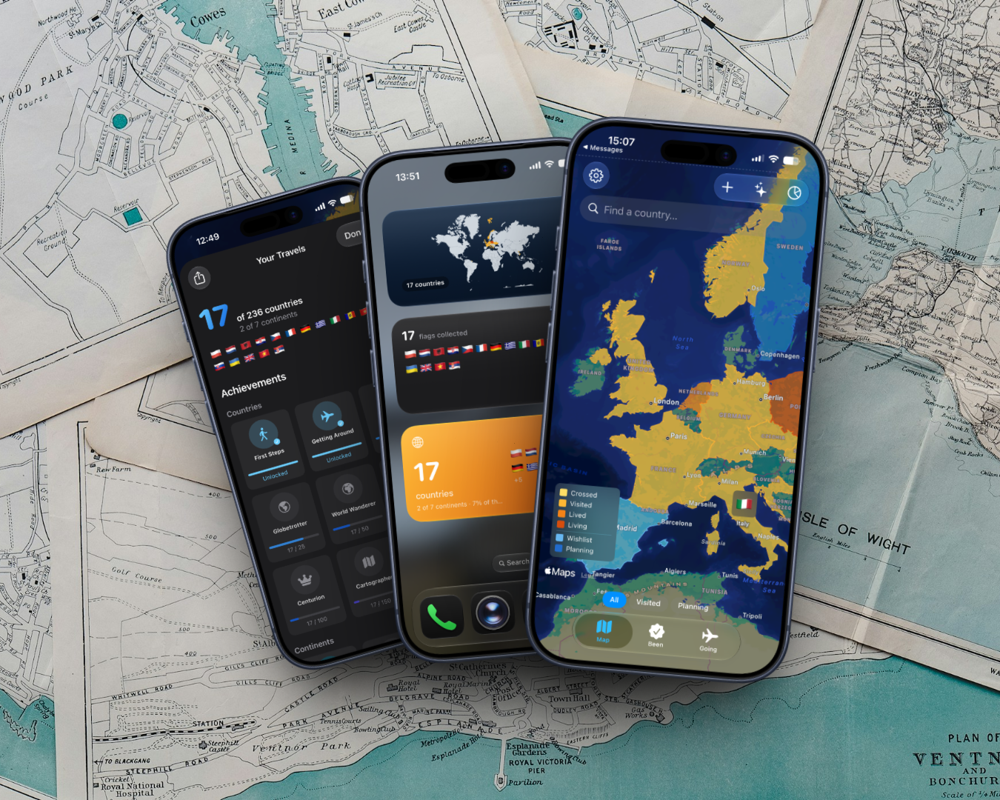
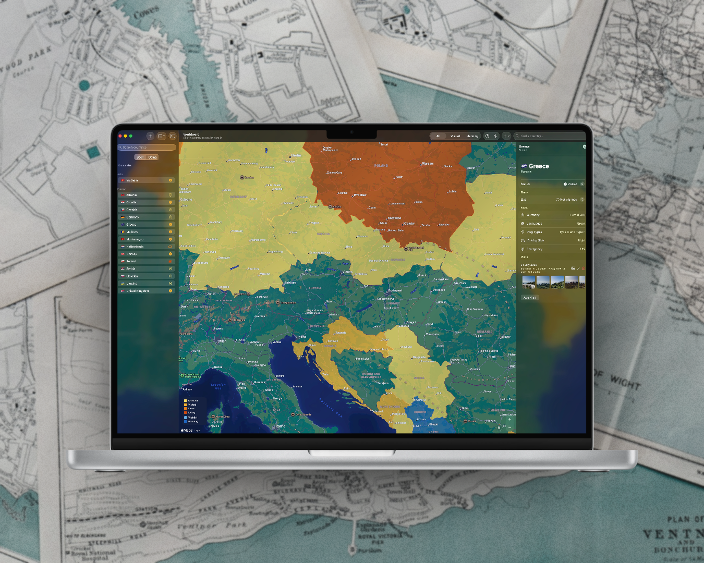
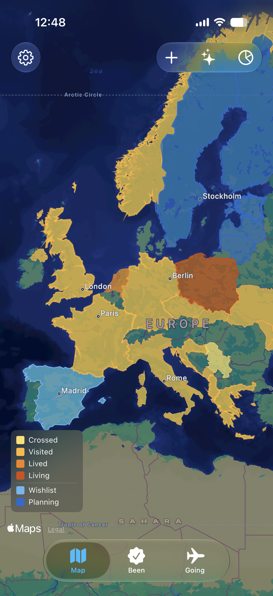
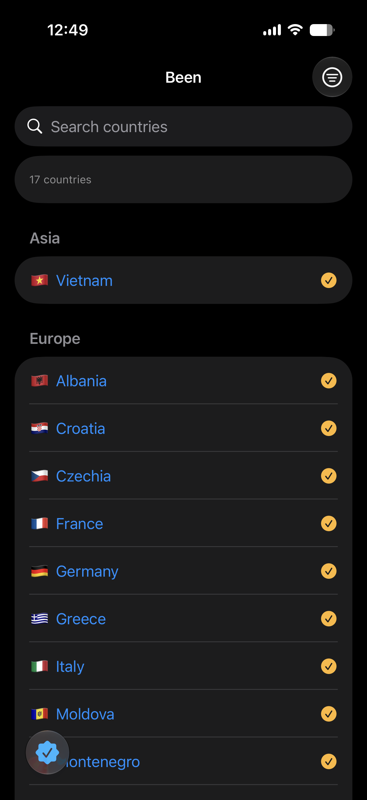
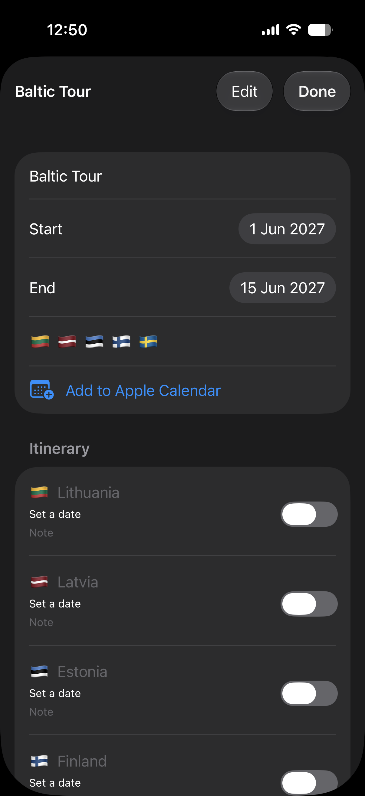
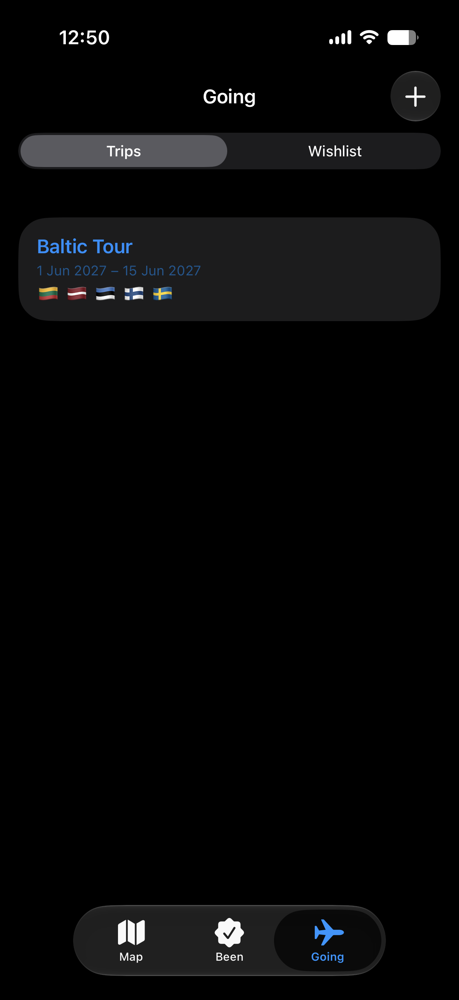
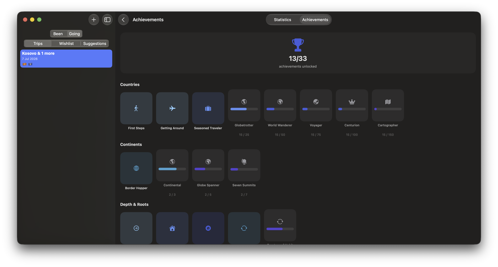

# Worldward 🌍

**Track your travels. Explore your world.**




Worldward is a native macOS / iOS app that visualises every country you've visited — crossed, lived in, or simply passed through — on an interactive world map. Built entirely with SwiftUI, MapKit, and SwiftData.


[](https://opensource.org/licenses/MPL-2.0)


---

## Table of Contents

- [Features](#features)
- [Screenshots](#screenshots)
- [Tech Stack](#tech-stack)
- [Localization](#localization)
- [Project Structure](#project-structure)
- [Getting Started](#getting-started)
- [Roadmap](#roadmap)
- [License](#license)

---

## Features

### Interactive Map

Every country rendered as a tap-able map polygon from Natural Earth data (~250 countries), including outlying territories and islands — Hawaii, Kaliningrad, the Greek archipelagos. Warm yellow-to-orange fill per status (**Crossed → Visited → Lived → Living**), with a cool-blue **planning layer** for Wishlist and Planning destinations.

- **Tap any country** to zoom in and open its detail sheet with visits, flag, and notes.
- **Search & fly-to** — type a country name and tap a suggestion to animate the map directly to it.
- **Status filter bar** — toggle between All, Visited only, or Planning only.
- **Map style picker** (Settings → Appearance) — Standard, Hybrid, or Satellite.
- **Flag annotations** float above selected countries.
- **Trip routes** — dashed itinerary lines with numbered stop badges and pins.

### Travel Log

- Record visits with dates and notes for every country.
- **Attach photos** from the system photo picker — thumbnails are fetched live from your library (only stable identifiers stored).
- Multiple visits per country, each with its own date and photo set.
- **Smart default date** — new visits default to one day after your most recent visit.

### Country Lists (Been / Going)

- **Been** tab: everywhere you've visited, with toolbar buttons for **Travel Chat** (AI) and **Statistics** (dashboard, timeline, charts, year recaps).
- **Going** tab: split into **Trips**, **Wishlist**, and **Suggestions**.
- Grouped by continent with sort by name or most recently visited, plus continent and year filters.
- **Quick-add** countries from the toolbar.
- **Fuzzy search** with diacritic and substring awareness ("cote" finds "Côte d'Ivoire").

### macOS

- **Menu Bar Extra** — a globe icon showing your country count with quick actions: Open Worldward, Mark Current Location, and Quit.

### Trips (multi-country itineraries)

- Multi-country trips through ordered **stops**, each optionally tied to a country.
- **Date range**, reorderable **itinerary**, checkable **packing list**, and free-text **notes**.
- **Add to Apple Calendar** as an all-day event (write-only EventKit).
- **Share / export** a trip as **Markdown** via the system share sheet.

### Achievements

- Badge grid with categories (Countries, Continents, Depth & Roots, Travel Log, Continent Mastery) and a hero counter.
- Every badge shows progress, computed on-device from `TravelStats`.
- **Unlock toasts** — newly earned badges are celebrated with a floating toast.

### Statistics & Timeline

- Dashboard: countries visited, continents covered, busiest year, per-year charts, cumulative **countries-over-time** line chart, **new-country streak**, continent completion.
- **Travel Timeline** — chronological history of every visit, grouped by year.
- **Year-in-review** with an **AI recap** (on-device).
- **Year share card** — customizable card with that year's countries tinted on the map.

### Suggestions

- **Closest unvisited countries** sorted by geographic distance.
- **Suggested for you** — Apple Intelligence picks with a one-line rationale, generated on-device.

### Apple Intelligence

- **Travel Chat** — free-form questions about your travels ("Which European countries haven't I been to?"). Runs on-device via Foundation Models.
- **AI Insights** — auto-generated year recaps and smart destination recommendations.

#### Translation Pipeline (LLM ↔ Device Language)

Apple's on-device language models generate text exclusively in English. Worldward bridges this gap using the **Translation framework**:

1. User input is translated from the device language **into English** before reaching the model.
2. The model processes the request and produces an English response.
3. The response is translated **back into the device language**.
4. **Fallback**: if the language pair isn't supported, the original English text passes through unchanged.

When the device language is already English, both translation steps are skipped entirely.

### Photo Import

- Scan your Photo Library to automatically detect countries from geotagged photos.
- Configurable merge gap and "Lived" threshold.
- Suggests statuses based on photo duration.
- Mark your most-present country as "home."

### Siri & Shortcuts

- `MarkCountryStatusIntent`, `LogVisitIntent`, `LogVisitsFromDescriptionIntent`
- `SearchCountriesIntent`, `GetVisitCountIntent`, `GetContinentProgressIntent`
- `MarkCurrentLocationIntent`

### Share

- Generate a share card (rasterised image) with your travel stats.
- Customisable headline, caption, metrics, gradient theme — optionally with your tinted world map and a **QR code**.
- Share as image or plain-text summary.

### Data Transfer

Two flows in **Settings**:

- **Backup (JSON)** — full-fidelity format: statuses, visits, notes, plans, trips. Restoring **replaces** travel data. For safekeeping between devices.
- **Spreadsheet (CSV)** — outward-facing exchange format. Export lists every visited country. Import is forgiving (delimiter/column auto-detected, fuzzy country matching, lenient dates, preview before writing) and **additive** — never overwrites.

### Widgets & Controls

- **Home Screen / desktop widgets**: Travel Snapshot, Flags Visited, tinted World Map, Upcoming Trip countdown.
- **Lock Screen accessories**: circular progress gauge, rectangular summary, inline count.
- **Control Center / Action button**: "Mark where I am" control.
- Widgets read a snapshot from a shared **App Group** — no SwiftData runs in the extension.

### Reminders

- Optional on-device notifications: "on this day" memories, **trip start reminder** (24 hours before), December year-in-review nudge, gentle prompt if you haven't logged a trip lately.
- **Off by default** — opt in from Settings.

### Packing

- Manage **packing containers** (bags/cases) and **packing templates** from Settings.
- Containers are shared across all trips; templates let you save and reuse packing lists.
- Customize with SF Symbol icons, drag to reorder, add items with quantities.

### Country Facts

- Bundled offline table: currency, languages, plug types, driving side, emergency number.
- Shown inline in the country detail sheet.
- The packing assistant uses these facts to recommend locale-specific items.

### Appearance

- System / Light / Dark theme preference.
- **Map style** picker (Standard / Hybrid / Satellite).
- Unified sky-to-royal-blue brand palette throughout.

### Data Portability

- Export / Import your travel data as JSON.
- Only your personal data (statuses, visits, notes, plans, trips) — the country catalog re-seeds from the bundled geometry file. Backups are versioned.

---

## Screenshots

### iOS

| | | |
|---|---|---|
|  |  |  |
| **Map** — Tap any country to view details, set status, and attach photos | **Photo Import** — Options for importing countries from Apple Photos | **Shortcuts** — Endpoints to automate your travel workflows |
|  |  |  |
| **Achievements** — Earn badges by travelling and view your stats | **Share Summary** — Share image or text with your progress | **Been** — Summary of every country you've visited |
|  |  |  |
| **Trips** — Details of your planned trips | **Going** — Summary of your travel plans | **Widgets** — Home/Lock Screen and Control Center with travel stats and map |

### macOS

| |
|---|
|  |
| **Map** — Tap any country to view details, set status, and attach photos |
|  |
| **Achievements** — Earn badges by travelling and view your stats |
|  |
| **Trips** — Details of your planned trips |

---

## Tech Stack

| Layer | Technology |
|---|---|
| UI | SwiftUI (Liquid Glass `TabView`, `.sidebarAdaptable`) |
| Mapping | MapKit (`MKPolygon`, `MKMapView`) |
| Persistence | SwiftData (`ModelContainer`, `@Model`) |
| Geo data | Natural Earth, pre-simplified to `countries.wmgb` (~675 KB) |
| PhotoKit | `PHAsset` / `PHImageManager` thumbnails |
| AI | `FoundationModels` (on-device, Apple Intelligence) |
| Intents | `AppIntents` framework (Shortcuts, Siri, Control Center) |
| Widgets | `WidgetKit` over an App Group |
| Notifications | `UserNotifications` (local, opt-in) |
| Calendar | `EventKit` (write-only) |
| Share | `ImageRenderer` → `ShareLink`, `CIFilter` (QR codes) |
| Localization | `String(localized:)` backed by Xcode String Catalogs |
| Platforms | macOS 26+, iOS 26+ |

---

## Localization

Worldward is fully translated into **28 languages** (plus English as the source). All user-facing strings are centralized via Xcode String Catalogs — every `Text(…)` and `String(localized:)` is automatically discovered at build time.

| Language | Code | | Language | Code |
|---|---|---|---|---|
| Bulgarian | `bg` | | Latvian | `lv` |
| Chinese (Simplified) | `zh-Hans` | | Lithuanian | `lt` |
| Croatian | `hr` | | Maltese | `mt` |
| Czech | `cs` | | Dutch | `nl` |
| Danish | `da` | | Polish | `pl` |
| Esperanto | `eo` | | Portuguese (Brazil) | `pt-BR` |
| Estonian | `et` | | Portuguese (Portugal) | `pt-PT` |
| Finnish | `fi` | | Romanian | `ro` |
| French | `fr` | | Slovak | `sk` |
| German | `de` | | Slovenian | `sl` |
| Greek | `el` | | Spanish | `es` |
| Hungarian | `hu` | | Swedish | `sv` |
| Irish | `ga` | | | |
| Italian | `it` | | | |
| Japanese | `ja` | | | |
| Korean | `ko` | | | |

The app detects the device language automatically — no manual selection needed.

### Adding a New Language

1. **Xcode → File → New → File → String Catalog** → name it `Localizable` and add it to the Worldward target.
2. **Build the project** — Xcode scans every `Text(…)` and `String(localized:)` call and populates the catalog.
3. **Click "+"** in the catalog to add your target language.
4. **Translate each entry** — the key is the English string; the context comment tells the translator where it appears.

For developers: write strings inline with `Text("Hello")` or `String(localized: "Hello", comment: "…")` — the catalog catches them on the next build.

---

## Project Structure

```
Worldward/
├── Worldward.swift              # App entry point, ModelContainer, ISO fallbacks
├── ContentView.swift           # Tabs (Map/Been/Going), map view, intents, sheets
├── CountryListView.swift       # Been/Going list with sort & filter
├── CountryDetailViews.swift    # Country detail, visit row, detail/location sheets
├── CountryFacts.swift          # Bundled offline facts (currency, plug types, …)
├── MapViews.swift              # Map polygons, legend, loading splash, country row
├── GeoLoading.swift            # Binary format decoder, polygon builder, CountrySeed
├── Country.swift               # SwiftData model for a country
├── Visit.swift                 # SwiftData model for a dated visit
├── Trip.swift                  # SwiftData models: Trip, ItineraryItem, PackingItem
├── TripViews.swift             # Going tab, trips list, trip editor, Markdown share
├── CalendarExporter.swift      # EventKit "Add to Apple Calendar" (write-only)
├── CountryStatus.swift         # "Been there" status enum
├── PlanStatus.swift            # "Going" plan enum
├── Continents.swift            # ISO → continent lookup table
├── TravelStats.swift           # All computed statistics + nearest-unvisited helper
├── Achievement.swift           # Gamification badges, derived from TravelStats
├── AchievementCelebration.swift# Unlock diffing + celebration toast
├── CSVTransfer.swift           # CSV parser, additive import, export
├── CSVImportView.swift         # CSV preview-and-confirm sheet
├── BrandColor.swift            # Brand palette + ShareCardTheme gradients
├── SettingsView.swift          # Appearance, reminders toggle, export/import
├── AchievementsView.swift      # Standalone badge grid (from Map toolbar)
├── StatisticsView.swift        # Dashboard, timeline, charts, AI recaps
├── ShareCard.swift             # Rasterised share-card view
├── ShareCustomizationView.swift# Live card preview + share flow
├── NotificationManager.swift   # Opt-in local travel reminders
├── WidgetSharedSnapshot.swift  # Shared snapshot/geometry + control intent
├── PhotoImporter.swift         # Photo Library scan → proposed trips
├── ImportPreviewView.swift     # Scan configuration & results UI
├── VisitPhotosView.swift       # Photo thumbnail strip + full-size viewer
├── TravelDataTransfer.swift    # JSON backup/restore
├── Intents/
│   ├── WorldwardIntents.swift   # AppIntents + Shortcuts provider
│   ├── CountryEntity.swift     # AppEntity for countries
│   ├── IntentSnippets.swift    # Snippet views for intent results
│   ├── LocationService.swift   # CoreLocation helper
│   ├── LogVisitsView.swift     # Bulk log-visits sheet
│   ├── TravelChatView.swift    # On-device AI chat sheet
│   ├── TravelInsights.swift    # AI year recaps + destination picks
│   ├── TravelIntelligence.swift# Conversational travel Q&A service
│   └── VisitLogParser.swift    # Natural-language visit parser
├── Assets.xcassets/            # App icon, launch screen, brand colors
├── countries.wmgb             # Pre-simplified country geometry (~239 countries)
├── PrivacyInfo.xcprivacy       # Privacy manifest
└── Info.plist                  # Launch screen + usage descriptions

WorldwardWidgets/               # Widget extension target
├── WorldwardWidgetsBundle.swift # @main WidgetBundle
└── WorldwardWidgets.swift      # Snapshot/Flags/Map/Trip widgets, accessories, control
```

> The app and widget extension share data through an **App Group** (`group.net.smigi.worldward`): the app writes a `WidgetSnapshot` and a copy of the map geometry; widgets read them. `WidgetSharedSnapshot.swift` is a member of both targets.

---

## Getting Started

1. Open `Worldward.xcodeproj` in **Xcode 16+**.
2. Select your target (macOS or iOS).
3. Build and run.
4. The first launch seeds the database from the bundled geometry file — this happens once.
5. Tap a country on the map, set its status, and start tracking.

> **Note**: Photo Import requires Photo Library access. AI features require Apple Intelligence on a supported device.

### Data & Privacy

- All travel data is stored **locally on-device** via SwiftData. Nothing is sent to a server.
- AI inference runs entirely on-device via `FoundationModels` — no network calls.
- Country geometry is loaded from the bundled `countries.wmgb` (Natural Earth data, public domain), pre-simplified at build time by `Tools/generate_geo.swift`. The app ships ~675 KB instead of a 14 MB GeoJSON, including outlying territories and islands down to ~25 km across (Hawaii, Kaliningrad, the Greek archipelagos, …). One deviation from the Natural Earth default view: Crimea is shown as part of Ukraine.
- Photo identifiers (`PHAsset.localIdentifier`) are stored instead of image data — the library stays the source of truth.

---

## Roadmap

Planned next, in rough priority order — everything stays native-only, lightweight, and local-first:

- **iCloud sync** — the schema is already CloudKit-safe (per-row dedup tokens, converging de-duplication); flipping it on awaits a paid Apple Developer membership.
- **December "Wrapped"** — a paged, animated year recap built from `TravelStats` and the on-device AI summary.

Under consideration:

- **Apple Watch app** — glanceable counts and "mark where I am" from the wrist; waiting on iCloud sync first.
- **Interactive packing widget** — check items off from the Home Screen.

---

## License

This project is licensed under the **Mozilla Public License 2.0 (MPL-2.0)**.
See the [LICENSE](LICENSE) file for the full text.

You are free to use, modify, and distribute this software, including for commercial purposes. Modifications to existing MPL-licensed files must be made available under the same license (MPL-2.0). You may combine this code with proprietary code in separate files as part of a larger work.
