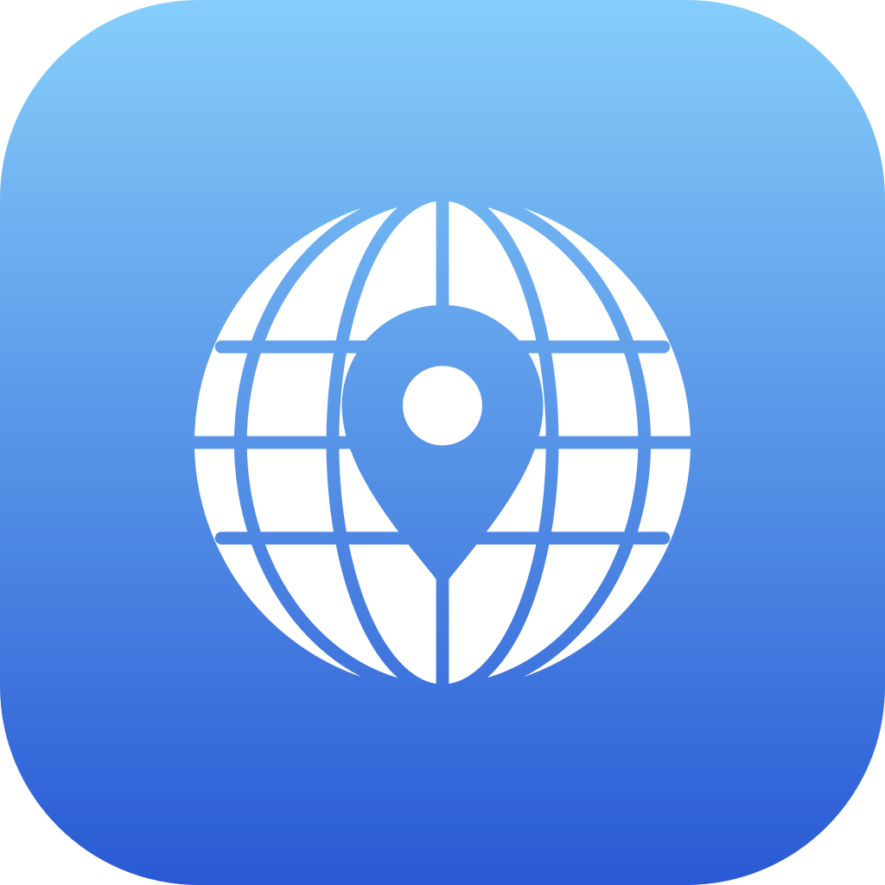
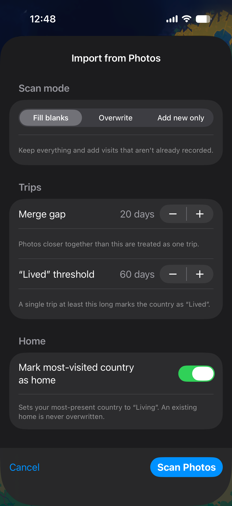
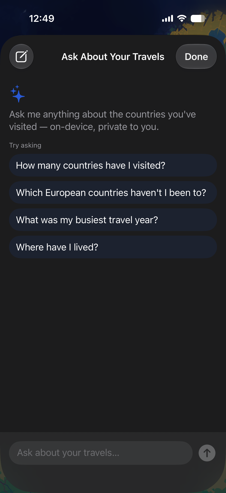
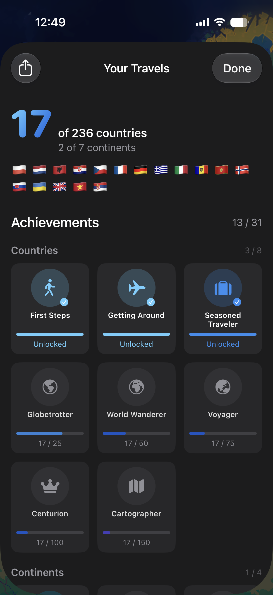
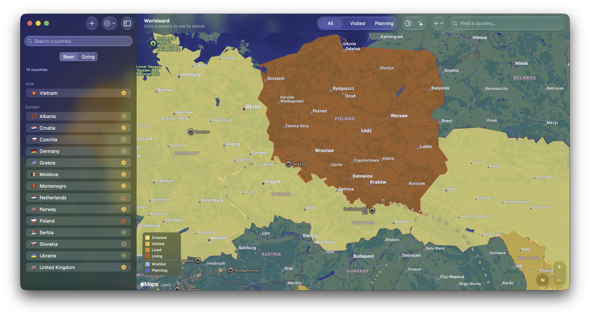
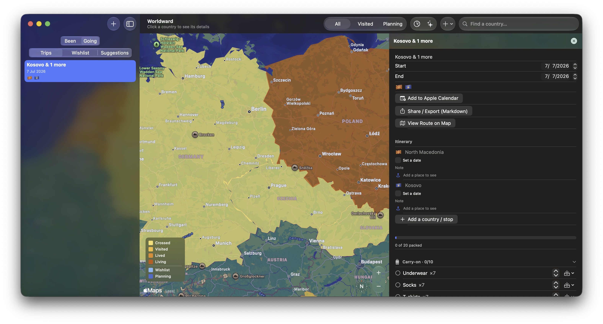

<div align="center">



# Worldward

**Track your travels. Explore your world.**

Every country you've crossed, visited or lived in — on a beautiful interactive map.
Log visits, plan trips, earn badges and watch your world fill with colour.
Native on iPhone, iPad, Mac and Apple Watch.

[](https://apps.apple.com/app/id6792382389)
[](https://worldward.smigi.net)


[](https://opensource.org/licenses/MPL-2.0)
[](CONTRIBUTING.md)

[Website](https://worldward.smigi.net) · [Privacy Policy](https://worldward.smigi.net/privacy) · [Contributing](CONTRIBUTING.md) · [Report a bug](https://github.com/lakafior/Worldward/issues)

</div>


---

## Private by design

Worldward is built the way personal software should be.

|  |  |
|---|---|
| 🔒 **Local-first** | Your travel data lives on your device. No server, no account, no sign-up. Optional iCloud sync uses *your* private CloudKit database. |
| 🚫 **No tracking** | No analytics, no ads, no third-party SDKs. **Zero third-party dependencies** — Apple frameworks only. |
| 🧠 **On-device AI** | Travel Chat, recaps and suggestions run through Apple Intelligence on your device. Nothing is sent to a cloud model. |
| 📦 **Yours to keep** | Export everything as JSON or CSV at any time. Open source under MPL-2.0. |

---

## A look around

### iPhone

| | | |
|---|---|---|
|  |  |  |
| **Map** — tap any country to set its status, log visits and attach photos | **Photo import** — turn geotagged photos into visits automatically | **Shortcuts** — automate your travel workflows with Siri |
|  |  |  |
| **Achievements** — earn badges as you travel | **Share** — a customisable card with your stats and tinted map | **Been** — every country you've visited, grouped by continent |
|  |  |  |
| **Trips** — itineraries, packing lists, attachments | **Going** — wishlist, plans and suggestions | **Widgets** — Home Screen, Lock Screen and Control Center |

### Mac

| |
|---|
|  |
| **Map** — a resizable window with a real sidebar layout |
|  |
| **Achievements** — the full badge grid |
|  |
| **Trips** — plan itineraries with a keyboard and a big screen |

---

## What it does

### 🗺️ Interactive map

~250 tap-able countries from Natural Earth data, down to outlying territories and islands — Hawaii, Kaliningrad, the Greek archipelagos. Warm yellow-to-orange for where you've been (**Crossed → Visited → Lived → Living**), cool blue for where you're going (**Wishlist → Planning**).

<details>
<summary>More about the map</summary>

- **Tap any country** to zoom in and open its detail sheet with visits, flag and notes.
- **Search & fly-to** — type a country name and tap a suggestion to animate the map to it.
- **Status filter bar** — All, Visited only, or Planning only.
- **Map style picker** (Settings → Appearance) — Standard, Hybrid or Satellite.
- **Flag annotations** float above selected countries.
- **Trip routes** — dashed itinerary lines with numbered stop badges and pins.
- **Fuzzy search** with diacritic and substring awareness ("cote" finds "Côte d'Ivoire").

</details>

### 📓 Travel log

Record visits with dates, notes and photos from your library. Multiple visits per country, each with its own story.

<details>
<summary>More about the travel log</summary>

- **Attach photos** from the system picker — thumbnails are fetched live from your library; only stable identifiers (`PHAsset.localIdentifier`) are stored, never image data.
- **Post-trip photo suggestions** — once a trip ends, its detail view offers the photos taken during it, grouped per country by location metadata, ready to attach in one tap.
- **Smart default date** — new visits default to one day after your most recent visit.
- **Been / Going tabs** — grouped by continent, sortable by name or recency, filterable by continent and year, with quick-add from the toolbar.

</details>

### 🧳 Trips & packing

Multi-country itineraries with reorderable stops, packing lists with reusable templates, calendar export, PDF and Markdown sharing.

<details>
<summary>More about trips and packing</summary>

- **Ordered stops**, each optionally tied to a country, with a date range and lightweight Markdown notes.
- **File attachments** — tickets, confirmations and boarding passes stored inside the trip, always available offline, previewed with Quick Look, and included in JSON backups.
- **Add to Apple Calendar** as an all-day event, or **two-way Calendar sync** (opt-in) into a dedicated "Worldward" calendar with an event per trip and per dated stop, `structuredLocation` set so Calendar shows maps and weather natively.
- **Export a trip** as Markdown or a formatted PDF, both with localized headers.
- **Send a trip to another Worldward user** as a `.wwtrip` file (AirDrop, Messages, Files). Re-sharing the same trip **updates** their copy instead of duplicating it, so a plan can bounce between two phones and improve on each pass.
- **Packing containers** (bags/cases) shared across trips, with SF Symbol icons and drag-to-reorder; **templates** save and reuse whole lists.
- **Two-way Apple Reminders sync** (opt-in) — tick an item off in Reminders, via Siri or on Apple Watch and it's packed in Worldward, and vice versa. Configurable auto-cleanup after a trip ends.

</details>

### 🏅 Achievements, stats & Wrapped

Badges for countries, continents, streaks and depth — all computed on-device and celebrated with a toast when you earn them.

<details>
<summary>More about statistics</summary>

- **Dashboard** — countries visited, continents covered, busiest year, per-year charts, cumulative countries-over-time line, new-country streak, continent completion.
- **Travel Timeline** — a chronological history of every visit, grouped by year.
- **Wrapped** — a full-screen, stories-style animated recap of any year, ending in a shareable card.
- **Share card** — customisable headline, caption, metrics, gradient theme, optional tinted world map and QR code.

</details>

### ✨ Apple Intelligence

Ask free-form questions about your travels ("Which European countries haven't I been to?"), get year recaps and destination picks — entirely on-device via Foundation Models.

<details>
<summary>How the translation pipeline works</summary>

Apple's on-device models generate text exclusively in English, so Worldward bridges the gap with the **Translation framework**:

1. Your input is translated from the device language **into English** before reaching the model.
2. The model produces an English response.
3. The response is translated **back into your language**.
4. If the language pair isn't supported, the English text passes through unchanged.

When the device language is already English, both steps are skipped.

</details>

### 📸 Photo import

Scan your photo library to detect countries from geotagged photos and turn them into visits, with a configurable merge gap and "Lived" threshold. Your photos never leave the device.

### 🧩 Widgets, Siri & Shortcuts

Home Screen and desktop widgets (Travel Snapshot, Flags Visited, tinted World Map, Upcoming Trip countdown), Lock Screen accessories, an interactive packing checklist widget, a Control Center "Mark where I am" button, and a full set of App Intents for Shortcuts and Siri.

### ⌚️ Apple Watch

Check today's itinerary and tick off your packing list from your wrist, with complications for your country count, next-trip countdown and packing progress. Synced over iCloud, with a `WatchConnectivity` channel so each check-off appears on your iPhone instantly.

### 🖥️ At home on the Mac

Not a port — a real macOS app: a sidebar layout with a **Go** menu and keyboard shortcuts, a **menu bar globe** showing your country count with quick actions, desktop widgets, and drag-and-drop-friendly import/export.

### 🌍 Country facts, reminders & data portability

A bundled offline table of currency, languages, plug types, driving side and emergency number per country — shown in the detail sheet and used by the packing assistant. Optional local notifications ("on this day", trip-start reminders, year-in-review nudges), off by default. Full **JSON backup** and forgiving **CSV import/export** in Settings.

---

## AI automation (MCP) — macOS

Worldward can be driven from an AI assistant on the same Mac over the [Model Context Protocol](https://modelcontextprotocol.io) — Claude Desktop, Claude Code, Cursor, VS Code or Zed can read your travels and, with permission, plan trips into the app.

macOS only: iOS can't keep a listener alive in the background, and there's no client there to talk to it.

- 🔴 **Off by default.** Switch it on in *Settings → Automation*.
- 🔒 **Loopback only** — the server binds to `127.0.0.1` and is unreachable from the network, however the Mac is configured.
- 🔑 **Bearer token** — a per-install random token, compared in constant time, regenerable from the same pane. It is only ever copied, never shown on screen.
- 🛡️ **Origin check** — requests from non-local web pages are rejected, stopping DNS-rebinding attacks.
- 👀 **Read-only mode** — turn off *Allow Changes* and only read tools run.
- 📴 **No dialing out.** Worldward never connects anywhere; a client connects in, or nothing happens.

<details>
<summary>Client configuration</summary>

Settings offers a ready-to-paste setup command for Claude Code, or a JSON snippet for JSON-configured clients:

```json
{
  "mcpServers": {
    "worldward": {
      "type": "http",
      "url": "http://127.0.0.1:8787/mcp",
      "headers": { "Authorization": "Bearer <your token>" }
    }
  }
}
```

Other clients read different files (`.vscode/mcp.json` uses a `servers` key, `.zed/mcp.json` an `mcp` key); the settings pane copies the right shape for the client you pick.

</details>

---

## Build from source

```bash
git clone https://github.com/lakafior/Worldward.git
cd Worldward
open Worldward.xcodeproj
```

1. Open `Worldward.xcodeproj` in **Xcode 16+**.
2. Pick the `Worldward` scheme and a macOS or iOS destination.
3. Set **Signing & Capabilities → Team** to your own Apple developer team (the checked-in team ID won't work for you), or build without signing:

```bash
xcodebuild -project Worldward.xcodeproj -scheme Worldward \
  -destination 'platform=macOS' -configuration Debug \
  CODE_SIGNING_ALLOWED=NO build
```

4. Build and run. The first launch seeds the database from the bundled geometry file — this happens once.

> **Publishing a fork?** Change the display name, bundle identifier and app icon first — the Worldward name and icon aren't covered by the code license. See [TRADEMARK.md](TRADEMARK.md).

> **Note:** Photo import needs Photo Library access. AI features need Apple Intelligence on a supported device. iCloud sync and the watch app need a paid developer account for the CloudKit container and App Group entitlements.

---

## Under the hood

<details>
<summary>Tech stack</summary>

| Layer | Technology |
|---|---|
| UI | SwiftUI (Liquid Glass `TabView`, `.sidebarAdaptable`) |
| Mapping | MapKit (`MKPolygon`, `MKMapView`) |
| Persistence | SwiftData (`ModelContainer`, `@Model`) + CloudKit (private DB, opt-out) |
| Geo data | Natural Earth, pre-simplified to `countries.wmgb` (~675 KB) |
| PhotoKit | `PHAsset` / `PHImageManager` thumbnails |
| AI | `FoundationModels` (on-device, Apple Intelligence) |
| Intents | `AppIntents` (Shortcuts, Siri, Control Center) |
| MCP | Local HTTP server over `Network` (loopback-only, bearer-token auth) |
| Widgets | `WidgetKit` over an App Group |
| Watch | watchOS companion — SwiftData + CloudKit, `WatchConnectivity` deltas, complications |
| Notifications | `UserNotifications` (local, opt-in) |
| Calendar | `EventKit` (Calendar + Reminders, two-way, opt-in) |
| Share | `ImageRenderer` → `ShareLink`, `CIFilter` (QR codes) |
| Localization | `String(localized:)` backed by Xcode String Catalogs |
| Platforms | iOS 26+, macOS 26+, watchOS 26+ |

**Constraints:** Swift 6, `SWIFT_STRICT_CONCURRENCY = complete`, zero third-party dependencies.

</details>

<details>
<summary>Project structure</summary>

```
Worldward/                       # Main app target
├── Worldward.swift              # App entry point, ModelContainer, ISO fallbacks
├── ContentView.swift            # Tabs (Map/Been/Going), map view, intents, sheets
├── Country.swift · Visit.swift · Trip.swift   # SwiftData models
├── CountryStatus.swift · PlanStatus.swift     # Status enums
├── GeoLoading.swift             # Binary .wmgb decoder, polygon builder
├── MapViews.swift · WorldMapView.swift        # Map polygons, legend, loading splash
├── CountryListView.swift · CountryDetailViews.swift
├── TripViews.swift · TripPlanner.swift · TripPDFExporter.swift
├── TripFileTransfer.swift       # .wwtrip app-to-app trip sharing
├── ManageContainersView.swift · ManageTemplatesView.swift
├── CalendarSync.swift · CalendarExporter.swift · ReminderSync.swift
├── TravelStats.swift · Achievement.swift · StatisticsView.swift · WrappedView.swift
├── ShareCard.swift · ShareCustomizationView.swift
├── PhotoImporter.swift · ImportPreviewView.swift · TripPhotoSuggestions.swift
├── TravelDataTransfer.swift · CSVTransfer.swift    # JSON + CSV portability
├── Translator.swift · Localization.swift
├── SettingsView.swift · AboutView.swift · NotificationManager.swift
├── API/                         # Shared API layer
│   ├── WorldwardAPI.swift · APIModels.swift · CountryResolver.swift
│   └── MCP/                     # MCPServer, stdio bridge, tool catalog
├── Intents/                     # AppIntents, Siri, Shortcuts, chat, insights
├── countries.wmgb               # Pre-simplified country geometry
└── PrivacyInfo.xcprivacy

WorldwardWidgets/                # Widget extension (stats, flags, map, trip, packing)
WorldwardWatch/                  # watchOS companion app
WorldwardWatchWidgets/           # watchOS complications
Tools/                           # generate_geo.swift (geometry), locman.py (localization)
website/                         # worldward.smigi.net (static, Cloudflare Workers)
```

The app and widget extension share data through an App Group (`group.net.smigi.worldward`): the app writes a `WidgetSnapshot` and a copy of the map geometry; widgets read them — no SwiftData runs in an extension.

</details>

<details>
<summary>Localization — 29 languages</summary>

English plus 28 translations. All user-facing strings go through `String(localized:)` and Xcode String Catalogs; the app follows the device language automatically.

| Language | Code | | Language | Code |
|---|---|---|---|---|
| Bulgarian | `bg` | | Latvian | `lv` |
| Chinese (Simplified) | `zh-Hans` | | Lithuanian | `lt` |
| Croatian | `hr` | | Maltese | `mt` |
| Czech | `cs` | | Dutch | `nl` |
| Danish | `da` | | Polish | `pl` |
| Esperanto | `eo` | | Portuguese (Brazil) | `pt-BR` |
| Estonian | `et` | | Portuguese (Portugal) | `pt-PT` |
| Finnish | `fi` | | Romanian | `ro` |
| French | `fr` | | Slovak | `sk` |
| German | `de` | | Slovenian | `sl` |
| Greek | `el` | | Spanish | `es` |
| Hungarian | `hu` | | Swedish | `sv` |
| Irish | `ga` | | | |
| Italian | `it` | | | |
| Japanese | `ja` | | | |
| Korean | `ko` | | | |

**Adding a language:** open `Localizable.xcstrings` in Xcode, click **+**, pick your language and translate. The key is the English string; the comment says where it appears. `Tools/locman.py` helps with bulk export/apply — see `python3 Tools/locman.py --help`.

</details>

---

## Roadmap

Everything stays native-only, lightweight and local-first.

- **WeatherKit forecasts** — a forecast per itinerary stop, shown natively in the trip detail view. Stops already store coordinates and dates, and no user permission is needed.

Have an idea? [Open an issue](https://github.com/lakafior/Worldward/issues).

---

## Contributing

Pull requests are welcome — see [CONTRIBUTING.md](CONTRIBUTING.md). In short: keep it native, keep it lightweight, add no third-party dependencies, and keep the MPL header on files you touch.

## Credits

- Country geometry from [Natural Earth](https://www.naturalearthdata.com) (public domain), pre-simplified by `Tools/generate_geo.swift` — ~675 KB shipped instead of a 14 MB GeoJSON. One deviation from the Natural Earth default view: Crimea is shown as part of Ukraine.

## License

The **code** is licensed under the **Mozilla Public License 2.0** — see [LICENSE](LICENSE).

You are free to use, modify and distribute it, including commercially. Modifications to existing MPL-licensed files must be released under the same license; you may combine this code with proprietary code in separate files as part of a larger work.

The **name "Worldward" and the app icon** are not part of that grant — MPL-2.0 §2.3 grants no trademark or logo rights. Fork freely and ship what you build, but ship it under your own name and your own icon. See [TRADEMARK.md](TRADEMARK.md) for the details, and email `worldward@smigi.net` if you want to use the brand for something.
